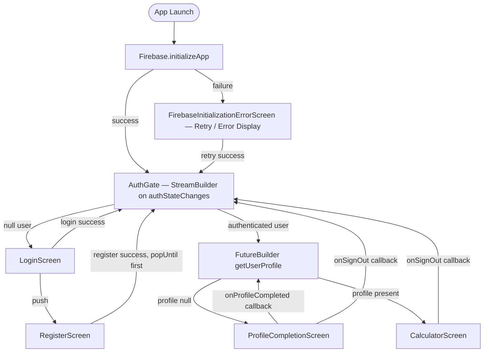

# LoanPal — Architecture

## 1. Overview

LoanPal is a Flutter application with a straightforward layered architecture. There is no third-party state-management library. State is held locally in `StatefulWidget` state objects, coordinated through callbacks, and updated by direct service calls. Firebase Authentication provides identity; Cloud Firestore persists user profiles.



---

## 2. Project Structure

```
lib/
├── core/
│   ├── constants/
│   │   └── validation_constants.dart   # Regex patterns and length limits
│   └── validators/
│       └── form_validators.dart        # Static validator functions for forms
├── firebase_options.dart               # Generated by FlutterFire CLI (do not edit)
├── logic/
│   ├── app_config.dart                 # Singleton ChangeNotifier; global calculator limits
│   └── emi_calculator.dart             # EMI math, amortisation schedule, burden level
├── main.dart                           # Firebase init, error screen, and app entry point
├── models/
│   └── user_profile.dart               # Domain model; Firestore serialisation/deserialisation
├── services/
│   ├── auth_service.dart               # Firebase Auth wrapper + profile coordination
│   └── user_profile_service.dart       # Firestore CRUD + in-memory profile singleton cache
├── ui/
│   ├── auth/
│   │   ├── auth_gate.dart              # Routing logic — unauthenticated / no-profile / app
│   │   ├── login_screen.dart           # Email/password login
│   │   ├── register_screen.dart        # Registration with profile creation
│   │   └── profile_completion_screen.dart  # Recovery screen for missing Firestore profiles
│   ├── admin_dashboard_screen.dart     # Developer settings dashboard for in-memory limits
│   ├── calculator_screen.dart          # Main EMI calculator UI with privacy-conscious greeting
│   └── theme.dart                      # Material 3 ThemeData derived from DESIGN.md tokens
├── utils/
│   └── currency_utils.dart             # Indian number-formatting helpers
└── widgets/
    ├── amortization_table.dart         # Month-by-month schedule table
    ├── burden_indicator.dart           # Colour-coded debt-burden level widget
    ├── input_slider.dart               # Labelled slider with live text input
    ├── principal_interest_bar.dart     # Stacked bar: principal vs interest ratio
    └── result_card.dart                # Summary card (EMI, total payable, total interest)
```

---

## 3. Application Startup & Initialization Handling

1. `main()` calls `WidgetsFlutterBinding.ensureInitialized()`.
2. `Firebase.initializeApp()` is called with the platform-specific options from `firebase_options.dart`.
3. If initialization succeeds, `initializationError` is `null` and `LoanPalApp` immediately mounts `AuthGate`.
4. If initialization throws an exception:
   - Diagnostic information (error message and stack trace) is captured and logged via `debugPrint`.
   - `LoanPalApp` mounts `FirebaseInitializationErrorScreen` instead of mounting widgets that depend on active Firebase services.
   - The error screen presents a clean, user-friendly message without leaking server secrets or sensitive infrastructure details.
   - In debug builds (`kDebugMode`), diagnostic error details are shown in a debug card.
   - A **Retry Connection** button re-invokes Firebase initialization and restarts the app flow upon recovery.

---

## 4. Authentication Flow

`AuthGate` is a `StatefulWidget` that owns a `StreamBuilder<User?>` listening to `AuthService.authStateChanges` (which delegates to `FirebaseAuth.authStateChanges()`).

| Auth state | Screen shown |
|---|---|
| Stream waiting (initial frame) | Full-screen loading spinner |
| `user == null` | `LoginScreen` |
| `user != null`, profile fetch in progress | Full-screen loading spinner |
| `user != null`, profile fetch error | Error screen with **Retry** and **Sign Out** buttons |
| `user != null`, profile missing | `ProfileCompletionScreen` (with `onSignOut` callback) |
| `user != null`, profile present | `CalculatorScreen` (with `userProfile` and `onSignOut` callback) |

### Login

`LoginScreen` calls `AuthService.signInWithEmailAndPassword`. On success, `authStateChanges` emits a non-null `User`; `AuthGate` automatically transitions without explicit navigation. Error strings are shown in a floating `SnackBar`.

### Registration

`RegisterScreen` calls `AuthService.registerWithEmailAndPassword`, which:

1. Creates the Firebase Auth account.
2. Calls `user.updateDisplayName` (best-effort sync; failure does not block registration).
3. Pre-caches the in-memory `UserProfile` in `UserProfileService`.
4. Writes the profile document to Firestore.
5. If the Firestore write fails, clears the cache and throws `ProfileCreationException`.

On complete success, the registration screen pops and `AuthGate` receives the pre-cached profile, immediately transitioning to `CalculatorScreen` without routing to `ProfileCompletionScreen`.

On `ProfileCreationException`, the user account is created but directed through `ProfileCompletionScreen` for recovery.

### Sign-Out & Service Decoupling

Sign-out is coordinated through `AuthGate`. Both `CalculatorScreen` and `ProfileCompletionScreen` accept an optional `onSignOut` callback rather than tightly coupling to `AuthService`. When sign-out is triggered:
1. `UserProfileService.clearCache()` clears the in-memory profile.
2. `FirebaseAuth.signOut()` ends the user session.
3. `AuthGate`'s stream listener re-renders `LoginScreen`.

---

## 5. User Profile Flow & Caching Strategy

```
Registration
  AuthService.registerWithEmailAndPassword
    └─► UserProfileService.setCachedProfile (pre-cache)
    └─► UserProfileService.createUserProfile (Firestore write)
         └─► on success → cache remains set
         └─► on failure → cache cleared, ProfileCreationException thrown

Login (existing user)
  AuthGate.FutureBuilder
    └─► UserProfileService.getUserProfile(uid)
         └─► cache hit (matching uid) → return cached profile
         └─► cache miss → Firestore read → cache result → return

Profile Recovery (ProfileCompletionScreen)
  UserProfileService.createUserProfile
    └─► Firestore set (with merge, preserving createdAt)
    └─► onProfileCompleted callback → AuthGate increments _refreshCounter
    └─► FutureBuilder re-runs with new ValueKey → profile is fetched again
```

### Cache Ownership & Singleton Architecture

`UserProfileService` is implemented as an explicit singleton using Dart's factory constructor pattern (`UserProfileService() => _instance`):
- `_cachedProfile` is an **instance-level field**, not static state.
- In-memory lookups verify that `_cachedProfile.uid == uid`. If a different user ID is requested (e.g., account switching), the cache is bypassed.
- When `signOut()` executes, `clearCache()` resets `_cachedProfile` to `null`.
- Test environments can inject an isolated mock Firestore via `UserProfileService(firestore: mockFirestore)` to produce an isolated test service instance with no shared cache leakage.

---

## 6. Logged-In User Identity & Privacy

On `CalculatorScreen`:
- **Identity Indicator:** A greeting card displays the authenticated user's first name (`"Hi, {FirstName}!"`) or username (`"Hi, {username}!"`) alongside a monogram circular avatar.
- **Privacy Protection:** The user's private email address is **never** displayed on screen. A neutral tagline (`"Smart EMI & Loan Planner"`) is displayed in the secondary position to prevent shoulder-surfing and email leakage in public environments.

---

## 7. Data Model

### `UserProfile`

| Field | Dart type | Firestore type | Notes |
|---|---|---|---|
| `uid` | `String` | `string` | Equals Firebase Auth UID; used as Firestore document ID |
| `username` | `String` | `string` | 3–20 chars, `[a-zA-Z0-9_]` |
| `firstName` | `String` | `string` | 2–50 chars, Unicode letters |
| `lastName` | `String` | `string` | 2–50 chars, Unicode letters |
| `email` | `String` | `string` | Copied from Firebase Auth at registration time |
| `createdAt` | `DateTime?` | `timestamp` | Server timestamp on creation; preserved on subsequent writes |

Passwords and password hashes are **never** stored in Firestore.

### Firestore Collection

Collection: `users`  
Document ID: Firebase Auth UID  
Example path: `/users/{uid}`

---

## 8. Validation

Validation rules live in two files:

- `lib/core/constants/validation_constants.dart` — centralized constants and `RegExp` objects.
- `lib/core/validators/form_validators.dart` — static methods conforming to Flutter's `FormFieldValidator<String?>` signature.

The validators are reused across `RegisterScreen` and `ProfileCompletionScreen`. Client-side validation improves UX; authoritative enforcement is maintained in Firestore Security Rules.

---

## 9. State Management

LoanPal uses **built-in Flutter state** only:

- `StatefulWidget` + `setState` for screen-local state (loading flags, form controllers, calculator values).
- `StreamBuilder<User?>` in `AuthGate` for reactive auth state.
- `FutureBuilder<UserProfile?>` in `AuthGate` for profile loading.
- `AppConfig` (singleton `ChangeNotifier`) + `addListener/removeListener` in `CalculatorScreen` for global calculator configuration.
- An in-memory instance-level cache in `UserProfileService` to avoid redundant Firestore reads.

---

## 10. Error Handling

| Layer | Strategy |
|---|---|
| `main.dart` | Captures initialization failure and displays `FirebaseInitializationErrorScreen` with retry. |
| `AuthService` | Catches `FirebaseAuthException`, maps codes to user-facing strings; throws `String` or `ProfileCreationException`. |
| `UserProfileService` | Catches all exceptions, wraps in `Exception('Failed to ...')`, clears cache on write failure, rethrows. |
| `AuthGate` | `FutureBuilder` `hasError` state shows a retry/sign-out error screen. |
| Screens | `try/catch` in event handlers; errors shown via floating `SnackBar` with `mounted` check. |

---

## 11. Security Boundaries & Administrator Authorization

| Boundary | Responsibility |
|---|---|
| Flutter client | Form validation (UX only), error messages, navigation |
| Firebase Authentication | Identity, password hashing, session tokens |
| Cloud Firestore | Document storage, access control via Security Rules |
| Firestore Security Rules | Authoritative enforcement: ownership, field validation, immutability of `uid` and `createdAt` |

### Administrator Authorization Architecture

1. **Local Developer Utility:**
   The `AdminDashboardScreen` modifies local in-memory `AppConfig` slider bounds only. Access is strictly gated behind Flutter's `kDebugMode`. In release builds (`!kDebugMode`), access is completely disabled.
   The previous client-side hardcoded PIN (`1234`) has been removed to eliminate false security assumptions.

2. **Production Administrative Operations:**
   If shared server-side administrative functionality is introduced, authorization **must not** rely on client-side PINs or client-side flags. Instead:
   - Administrator status must be assigned via **Firebase Authentication Custom Claims** (`admin: true`) managed by a trusted backend or Firebase Admin SDK script.
   - Firestore Security Rules must enforce claims server-side:
     ```javascript
     match /admin_config/{docId} {
       allow read, write: if request.auth != null && request.auth.token.admin == true;
     }
     ```
